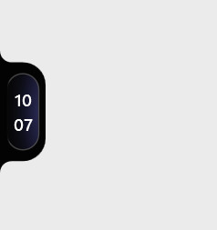
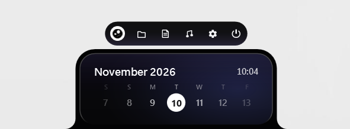
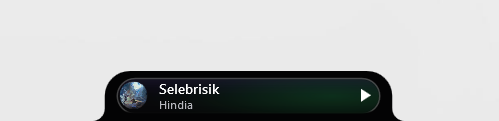
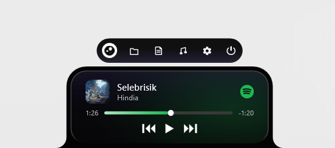
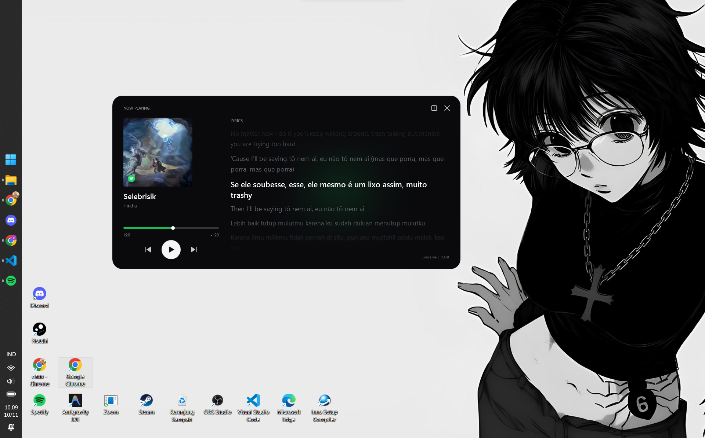
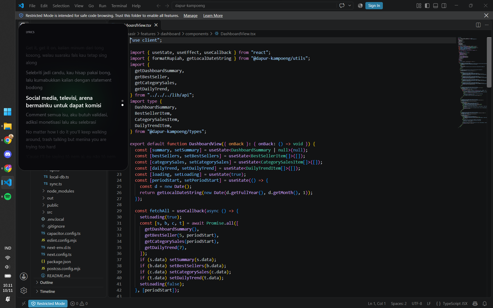

  

  <a href="README.md">English</a> | <a href="READMEindo.md">Bahasa Indonesia</a>

## Overview

Notchi is a native notch overlay for Windows 10 and Windows 11, inspired by the macOS notch and Dynamic Island. It stays above the desktop, remains compact while idle, and expands on hover to show media controls, a calendar, system information, and file tools. The application is built with C#, WPF, and .NET 8 without Electron, keeping it lightweight and responsive.

## System Requirements

| Component | Minimum | Recommended |
| :--- | :--- | :--- |
| Operating system | Windows 10 version 2004 (build 19041), 64-bit | Windows 11 version 22H2 or later, 64-bit |
| Architecture | x64 | x64 |
| Processor | 1 GHz dual-core or equivalent | 2 GHz quad-core or equivalent |
| Memory | 4 GB RAM | 8 GB RAM |
| Storage | 150 MB free space | 250 MB free space on an SSD |
| Display | 1280 x 720 | 1920 x 1080 or higher |

The release installer is per-user and does not require administrator privileges.

## Installation

Download the latest `NotchiSetup-x64.exe` from the [Releases](https://github.com/risuunava/Notchi/releases/latest) page and run it, then launch Notchi from the Start menu. SHA-256 checksums for each release are published in the release notes.

## Features

| Feature | Description |
| :--- | :--- |
| Always-on-top overlay | Keeps the notch visible above other windows without appearing in the taskbar. |
| Compact and expanded modes | Stays compact while idle and expands smoothly when the cursor moves over it. |
| Dome mode | Double-click the notch to collapse it into a minimal, low-profile dark arch along the screen edge. |
| Paginated idle view | The expanded idle state has three pages navigated with the mouse wheel: Calendar, Last media, and Metrics, with animated slide transitions. |
| Media controls | Integrates with Windows System Media Transport Controls for track title, artist, album art, source app, elapsed time, duration, seeking, play/pause, and previous/next. Progress bar dynamically tints to match the active source app. |
| Media Focus mode | A dedicated 760 x 380 non-activating card window with synchronized lyrics from LRCLIB, dynamic cover art glow, visualizer fallback, and dedicated hotkey (`Ctrl+Shift+M`). |
| Last media | Remembers the most recently played track, including artwork, playback controls, and seeking, after the media session ends. |
| System dashboard | Displays a clean compact clock with a subtle time gradient, date, and live CPU, RAM, disk, and battery bars. |
| Calendar notes | Click any date to create, edit, or delete a note. Dates with notes show an indicator dot and a hover preview, and Shift + scroll navigates between dates. |
| Notes | Provides a dedicated, resizable notes window with automatic saving. |
| File drop shelf | Accepts files dragged onto the notch and supports opening files, revealing them in Explorer, copying paths, opening all items, removing individual items, and clearing the list. |
| Share to mobile | Drag files onto the notch drop shelf to transfer them directly to paired mobile devices. |
| Mobile Companion | Built-in Kestrel HTTP and WebSocket service providing instant QR pairing, system volume synchronization, and mobile device management. |
| File conversion | Drag PDF, DOC, or DOCX files onto the notch to convert PDF to DOCX or Word documents to PDF directly into Downloads, with inline progress and scanned-PDF detection. |
| Feature bar | A bottom bar with active indicators where only one panel opens at a time, animated outward from the center logo. Clicking the logo restarts the app. |
| Draggable windows | The note, file shelf, and settings popups can be dragged, remember their last position, and snap magnetically to screen edges. |
| Screen anchoring | Supports docking the notch at top center, bottom center, left center, or right center of the screen with adaptive layout orientation. |
| Persistent position | Saves the last anchor and restores it on the next launch. |
| Global shortcuts | Customizable system-wide hotkeys for toggling the notch (`Ctrl+Shift+N`) and Media Focus mode (`Ctrl+Shift+M`). |
| Settings | Redesigned with segmented tabs (General, Appearance, Media Focus, Mobile Devices, Hotkeys), interactive hotkey recording, language selection, and paired device management. |
| Lightweight design | Uses native WPF rendering with low idle CPU usage and private memory below 100 MB. |

## Preview

The screenshots below show the compact and expanded states of the main views.

<table>
  <tr>
    <td align="center" width="50%">
       
      <b>Compact mode</b> &middot; idle clock
    </td>
    <td align="center" width="50%">
       
      <b>Side anchor</b> &middot; docked to the screen edge
    </td>
  </tr>
  <tr>
    <td align="center" colspan="2">
       
      <b>Feature menu</b> &middot; calendar, notes, files, media, and settings
    </td>
  </tr>
  <tr>
    <td align="center" width="50%">
       
      <b>Compact media</b> &middot; now playing at a glance
    </td>
    <td align="center" width="50%">
       
      <b>Expanded media</b> &middot; artwork, seeking, and playback controls
    </td>
  </tr>
  <tr>
    <td align="center" colspan="2">
       
      <b>Media Focus</b> &middot; synced lyrics card over the desktop
    </td>
  </tr>
  <tr>
    <td align="center" colspan="2">
       
      <b>Media Focus</b> &middot; non-activating card while you work
    </td>
  </tr>
</table>

## Latest Update

| Version | Released | Status |
| :--- | :--- | :--- |
| 2.1.0 | November 10, 2026 | Latest stable |

Version 2.1.0 is the current stable release. It introduces Media Focus mode (a 760 x 380 non-activating card with live playback controls, synced lyrics from LRCLIB, ambient artwork glow, visualizer fallback, and dedicated hotkey `Ctrl+Shift+M`), Notchi Mobile Companion integration with QR pairing, system volume synchronization, and drop shelf file sharing. This release also brings Dome mode, bottom-center screen anchoring with adaptive popups, a layered notch sleeve silhouette, and a segmented settings interface. Full release notes are available on the [Releases](https://github.com/risuunava/Notchi/releases) page.

## Install Notchi Mobile

Get the latest version of **Notchi Mobile** and enjoy the updated experience.

[Download & Install Notchi Mobile](https://github.com/risuunava/notchi-mobile/releases)

## Contributing

Contributions are welcome, including bug reports, feature proposals, documentation improvements, and pull requests. Before contributing, read [CONTRIBUTORS.md](CONTRIBUTORS.md) for the contributor list, roles, and contribution workflow. For significant changes, open an issue first so the approach can be discussed.

  
  

## Contact

Developer: **risuunava**

  
  
  

## License

Notchi is released under the Apache License 2.0. See [LICENSE](LICENSE) for details.
