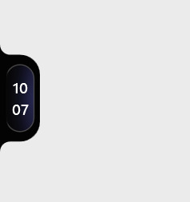
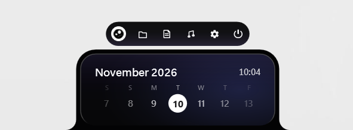
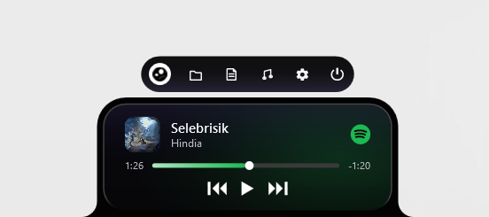
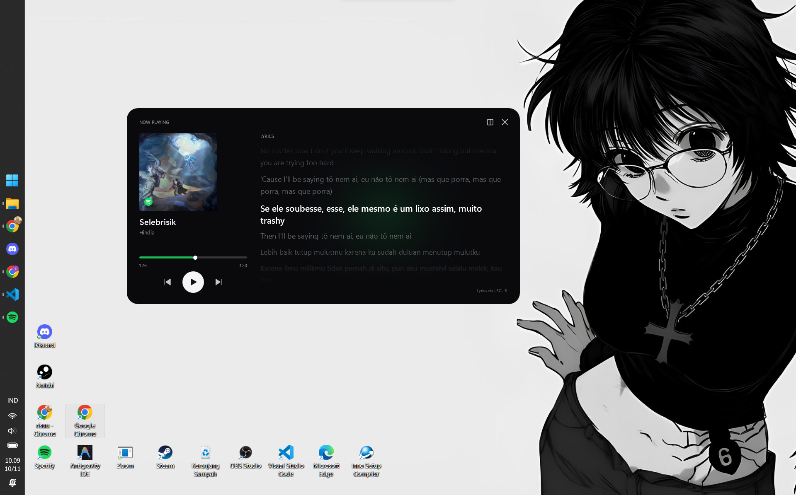
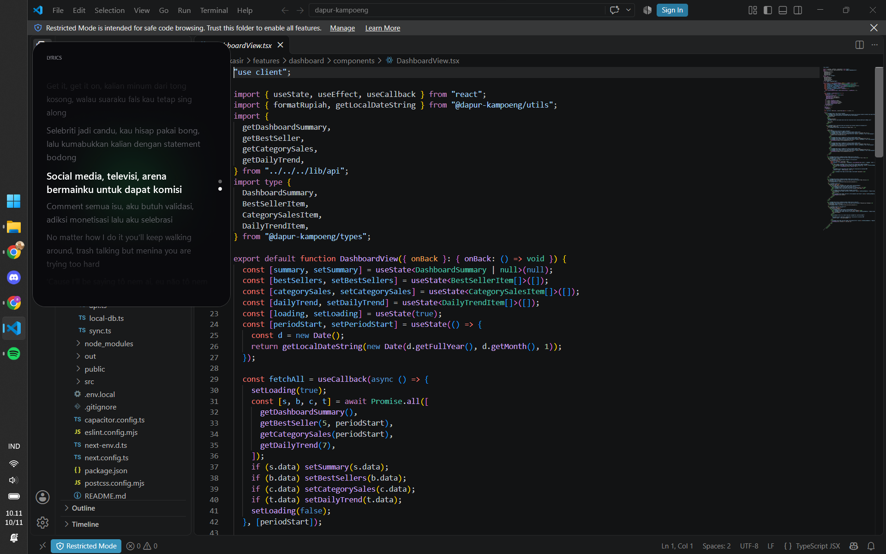

  

  <a href="README.md">English</a> | <a href="READMEindo.md">Bahasa Indonesia</a>

## Ringkasan

Notchi adalah overlay notch native untuk Windows 10 dan Windows 11 yang terinspirasi oleh notch macOS dan Dynamic Island. Aplikasi tetap berada di atas desktop, tampil ringkas saat idle, dan mengembang saat kursor diarahkan untuk menampilkan kontrol media, kalender, informasi sistem, serta alat file. Aplikasi dibangun dengan C#, WPF, dan .NET 8 tanpa Electron sehingga tetap ringan dan responsif.

## Spesifikasi Sistem

| Komponen | Minimum | Disarankan |
| :--- | :--- | :--- |
| Sistem operasi | Windows 10 versi 2004 (build 19041), 64-bit | Windows 11 versi 22H2 atau lebih baru, 64-bit |
| Arsitektur | x64 | x64 |
| Prosesor | Dual-core 1 GHz atau setara | Quad-core 2 GHz atau setara |
| Memori | RAM 4 GB | RAM 8 GB |
| Penyimpanan | Ruang kosong 150 MB | Ruang kosong 250 MB pada SSD |
| Layar | 1280 x 720 | 1920 x 1080 atau lebih tinggi |

Installer rilis bersifat per-user dan tidak memerlukan hak administrator.

## Instalasi

Unduh `NotchiSetup-x64.exe` versi terbaru dari halaman [Releases](https://github.com/risuunava/Notchi/releases/latest), jalankan installer, lalu buka Notchi dari Start menu. Checksum SHA-256 untuk setiap rilis tersedia di catatan rilis.

## Fitur

| Fitur | Deskripsi |
| :--- | :--- |
| Overlay selalu di atas | Menjaga notch tetap terlihat di atas jendela lain tanpa muncul di taskbar. |
| Mode ringkas dan mengembang | Tampil ringkas saat idle dan mengembang dengan animasi halus saat kursor diarahkan. |
| Dome mode | Klik dua kali pada notch untuk menyusutkannya menjadi lengkungan hitam minimalis di tepi layar. |
| Tampilan idle berpaginasi | Tampilan idle yang mengembang memiliki tiga halaman yang dinavigasi dengan scroll mouse: Kalender, Media terakhir, dan Metrik, dengan transisi animasi. |
| Kontrol media | Terintegrasi dengan Windows System Media Transport Controls untuk judul lagu, artis, album art, aplikasi sumber, waktu berjalan, durasi, seek, play/pause, serta previous/next. Warna progress bar beradaptasi mengikuti aplikasi sumber. |
| Mode Fokus Media | Kartu jendela 760 x 380 non-activating khusus pemutar musik dengan lirik sinkron dari LRCLIB, efek pendaran sampul album, fallback visualizer, dan hotkey khusus (`Ctrl+Shift+M`). |
| Media terakhir | Mengingat lagu terakhir yang diputar, termasuk album art, kontrol pemutaran, dan seek, setelah sesi media berakhir. |
| Dashboard sistem | Menampilkan jam ringkas yang bersih dengan gradasi halus pada waktu, tanggal, serta bar CPU, RAM, disk, dan baterai secara langsung. |
| Catatan kalender | Klik tanggal mana pun untuk membuat, mengubah, atau menghapus catatan. Tanggal dengan catatan menampilkan titik indikator dan pratinjau saat hover, serta Shift + scroll untuk berpindah tanggal. |
| Catatan | Menyediakan jendela catatan khusus yang dapat diubah ukurannya dengan penyimpanan otomatis. |
| File drop shelf | Menerima file yang ditarik ke notch dan mendukung membuka file, menampilkan di Explorer, menyalin path, membuka semua item, menghapus item satu per satu, serta membersihkan daftar. |
| Berbagi ke mobile | Tarik file ke drop shelf notch untuk mengirimkannya langsung ke perangkat mobile yang terhubung. |
| Notchi Mobile Companion | Layanan internal Kestrel HTTP dan WebSocket untuk pairing instan lewat QR code, sinkronisasi volume sistem, dan manajemen perangkat mobile. |
| Konversi file | Tarik file PDF, DOC, atau DOCX ke notch untuk mengonversi PDF ke DOCX atau dokumen Word ke PDF langsung ke folder Downloads, dengan progres inline dan deteksi PDF hasil scan. |
| Feature bar | Bar bawah dengan indikator aktif di mana hanya satu panel yang terbuka pada satu waktu, beranimasi keluar dari logo tengah. Klik logo untuk memulai ulang aplikasi. |
| Jendela dapat digeser | Popup catatan, file shelf, dan pengaturan dapat digeser, mengingat posisi terakhirnya, dan menempel magnetis ke tepi layar. |
| Penempatan di layar | Mendukung docking notch di atas tengah, bawah tengah, kiri tengah, atau kanan tengah layar dengan orientasi popup yang adaptif. |
| Posisi tersimpan | Menyimpan anchor terakhir dan memulihkannya saat aplikasi dibuka kembali. |
| Pintasan global | Pintasan sistem yang dapat disesuaikan untuk menyembunyikan/menampilkan notch (`Ctrl+Shift+N`) dan membuka Fokus Media (`Ctrl+Shift+M`). |
| Pengaturan | Tampilan baru dengan tab tersegmentasi (Umum, Tampilan, Fokus Media, Perangkat Mobile, Pintasan), perekam kombinasi tombol, pilihan bahasa, dan pengelolaan perangkat mobile. |
| Desain ringan | Menggunakan rendering native WPF dengan pemakaian CPU idle rendah dan memori privat di bawah 100 MB. |

## Tampilan

Tangkapan layar berikut menunjukkan tampilan ringkas dan mengembang dari setiap bagian utama.

<table>
  <tr>
    <td align="center" width="50%">
       
      <b>Mode ringkas</b> &middot; jam saat idle
    </td>
    <td align="center" width="50%">
       
      <b>Mode sisi</b> &middot; menempel di tepi layar
    </td>
  </tr>
  <tr>
    <td align="center" colspan="2">
       
      <b>Menu fitur</b> &middot; kalender, catatan, file, media, dan pengaturan
    </td>
  </tr>
  <tr>
    <td align="center" width="50%">
       
      <b>Media ringkas</b> &middot; lagu yang diputar sekilas
    </td>
    <td align="center" width="50%">
       
      <b>Media mengembang</b> &middot; album art, seek, dan kontrol pemutaran
    </td>
  </tr>
  <tr>
    <td align="center" colspan="2">
       
      <b>Fokus Media</b> &middot; kartu lirik sinkron di atas desktop
    </td>
  </tr>
  <tr>
    <td align="center" colspan="2">
       
      <b>Fokus Media</b> &middot; kartu non-activating saat bekerja
    </td>
  </tr>
</table>

## Pembaruan Terakhir

| Versi | Tanggal Rilis | Status |
| :--- | :--- | :--- |
| 2.1.0 | 10 November 2026 | Stabil terbaru |

Versi 2.1.0 adalah rilis stabil saat ini. Rilis ini menghadirkan mode Fokus Media (kartu 760 x 380 non-activating dengan kontrol pemutaran, lirik sinkron dari LRCLIB, pendaran sampul album, visualizer cadangan, dan hotkey khusus `Ctrl+Shift+M`), integrasi Notchi Mobile Companion dengan pairing QR, sinkronisasi volume sistem, dan transfer file drop shelf. Pembaruan ini juga memperkenalkan Dome mode, penempatan layar bawah-tengah dengan popup adaptif, desain layered sleeve pada bodi notch, dan pengaturan bertab tersegmentasi. Catatan rilis selengkapnya tersedia di halaman [Releases](https://github.com/risuunava/Notchi/releases).

## Kontribusi

Kontribusi sangat diterima, termasuk laporan bug, usulan fitur, perbaikan dokumentasi, dan pull request. Sebelum berkontribusi, baca [CONTRIBUTORS.md](CONTRIBUTORS.md) untuk melihat daftar kontributor, peran, dan alur kontribusi. Untuk perubahan besar, buka issue terlebih dahulu agar pendekatannya dapat didiskusikan.

  
  

## Kontak

Developer: **risuunava**

  
  
  

## Lisensi

Notchi dirilis di bawah Apache License 2.0. Lihat [LICENSE](LICENSE) untuk detailnya.
